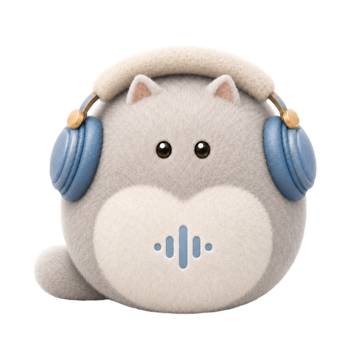

<p align="center"></p>
<h1 align="center">Lulu</h1>
<p align="center"><strong>完全开源、本地优先的 macOS 内容工作台。</strong></p>
<p align="center">Apple Silicon · macOS 15+ · MIT · 无遥测 · 无激活码</p>

当前版本为 **4.3.2**。正式下载以 [GitHub Releases](https://github.com/AidenXu-1/Lulu/releases/latest) 为准。

Lulu 将音视频转成可整理的文字，并提供主页采集、直播录制、本地配音、文稿与音频管理，以及文稿旁的 AI 助手。完整产品源码、界面资源、后台与 CLI、构建脚本和 Agent Skill 都公开，支持自行运行、修改和构建。第一方代码采用 [MIT 许可](LICENSE)，第三方组件和模型遵守各自许可。

## 4.3.2 更新内容

* **逐作品内容提取**：每条作品独立选择文案、视频与封面，保留模型与素材设置，支持批量处理及取消、继续和恢复。
* **缺失内容补充提取**：文稿被移出或删除后可直接补充，保留已经取得的视频与封面。
* **任务卡与导航更连贯**：新任务直接出现在最前方，其他卡片平滑让位；七个侧栏入口统一使用浅底色、小圆角与连续滑动指示器。
* **修复连续切页闪退**：改进主页采集状态读取和界面资源生命周期。
* **修复主页批量转录衔接**：同一抖音作品的分享页与作品页正确对应，图文跳过，真正的编号不符仍拦截。
* **录像状态更准确**：正常结束后的末尾等待不再误报录制缺口，实际中间断流和失败提示保留；支持已有录像的整场导出。
* **批量转录与Agent调用完善**：本地共享资源按序执行，云端按服务规则调度；未知结果先核对，普通重试不盲目重新上传。CLI和Skill按当前功能清单发现采集、导出、素材与直播管理入口。
* **资料与模型保留**：覆盖更新沿用已有资料、模型、任务和配置。主页采集本次保留既有布局，未纳入未采用的独立设计预览。

## 使用方式

| 入口 | 用途 |
| --- | --- |
| 内容提取 | 导入音视频或粘贴受支持的作品链接，生成文字并整理素材。 |
| 主页采集 | 按平台支持的范围采集公开作品；需要登录的流程由使用者本人完成。 |
| 直播录制 | 查看主播状态，监控、录制、查看分段和弹幕。 |
| 文案配音 | 使用已准备好的本地模型和音色。 |
| 文稿与音频库 | 查找、编辑、组织、导出自己的资料。 |
| AI 助手 | 连接使用者自己的模型服务，围绕文稿继续处理。 |

## 安装、模型与更新

从 [Releases](https://github.com/AidenXu-1/Lulu/releases/latest) 下载正式安装包，将 Lulu.app 放入“应用程序”并打开。当前包使用 ad-hoc 签名，尚未采用 Developer ID 签名和 Apple 公证；系统密码与授权由使用者本人处理。

在“AI 大模型”中选择需要的模型。模型独立存放，普通覆盖更新无需重新下载。云端连接由使用者自愿配置；本地转录无需云端 API 或激活码。4.1.x 及更早版本首次升级需手动覆盖一次，4.2.1 起支持应用内更新；更新清单和文件均经过签名与摘要核验。

## 让 Agent 调用 Lulu

CLI 随 App 提供，配套 [Lulu Agent Skill](agent-skill/README.md) 可独立安装。先校验本机安装，再查询实际开放能力；不同版本的能力和模型以当前 App 返回结果为准。

```text
请阅读 https://github.com/AidenXu-1/Lulu/tree/main/agent-skill 的安装说明，完整安装 lulu-agent 到当前 Agent 的技能目录。保留 scripts 和 references，检查已有同名副本并只启用一个入口。安装后按 SKILL.md 校验本机 Lulu，再查询可用功能。本次只安装和检查连接，不下载模型、不修改文稿、不执行转录、配音或云端调用。
```

主页采集、直播监控、录像管理及整场导出等入口按本机实际功能清单使用；旧版App不会因更新Skill自动获得新能力。

## 源码与构建

完整说明见 [BUILDING.md](BUILDING.md)。源码包含产品 GUI、后台、CLI、原生通信、当前 1326 项正式产品检查及必要夹具、配套 Skill、前端源文件、依赖和构建入口。私人开发历史、旧授权码后台、一次性操作工具、用户资料、模型权重和签名私钥不属于产品源码。

| 目录 | 内容 |
| --- | --- |
| app/src | 产品实现与界面资源 |
| app/native | 原生通信源码 |
| app/packaging | 构建、安装与包体校验；配音和原生 ASR 构建入口 |
| app/tests | 当前正式产品检查与必要夹具 |
| app/skills、agent-skill | 随包与独立 Agent Skill |

## 数据与联网

默认本地转录在 Mac 上完成。链接采集和直播需要连接对应平台；云端 AI 仅在使用者主动调用时发送必要内容，飞书导出仅发送使用者选择的资料。Lulu 不加入遥测。第三方库、媒体工具和模型的来源与许可见 [第三方说明](THIRD_PARTY_NOTICES.md)。

本版产品实现已完成转录、资料保留、连续切页及录像状态的针对检查，并在本机实际完成主页批量转录4/4及文稿保存。正式构建另执行1326项固定产品检查、包内运行和签名校验；公开发布后的下载与更新验收另行核对。未完整实测全部云厂商、多小时直播、其他电脑或系统。\n